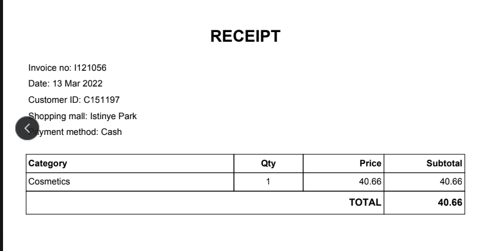
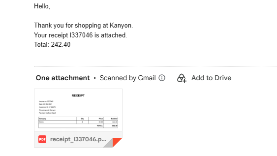

# Invoice Automation

A Python tool that turns sales data into PDF receipts and emails them to customers automatically.

**Pipeline:** CSV files → merge & group by invoice → PDF receipt per invoice → email each customer → log the result

<p>
  
  
</p>

## Features

- Merges sales, customer, and email data with pandas
- Builds one receipt per invoice, even when an invoice has several items
- Generates clean PDF receipts with fpdf2
- Sends each PDF to the right customer through Gmail (SMTP)
- **Dry run by default**: nothing is emailed unless you pass `--send`
- **No duplicates**: a send log records every attempt, so re-running never emails the same invoice twice
- **Fault tolerant**: missing or invalid emails are skipped and logged; one failed send doesn't stop the batch
- Credentials come from environment variables, never from the code

## Project structure

```
├── main.py           # command-line entry point and orchestration
├── data_loader.py    # loads/merges CSVs and builds Receipt objects
├── receipt.py        # the Receipt class
├── pdf_builder.py    # creates the PDF for a receipt
├── emailer.py        # sends the email with the PDF attached
├── data/             # small sample CSVs (fake data)
└── requirements.txt
```

## Setup

```bash
pip install -r requirements.txt
```

## Usage

Dry run with the sample data (creates PDFs, sends nothing):

```bash
python main.py \
  --sales data/sample_sales.csv \
  --customers data/sample_customers.csv \
  --emails data/sample_emails.csv
```

Output goes to `output/pdfs/` and `output/send_log.csv`.

### Sending real emails

1. Turn on 2-Step Verification on your Google account and create an **app password**.
2. Set the credentials as environment variables:

   ```bash
   export GMAIL_ADDRESS="you@gmail.com"
   export GMAIL_APP_PASSWORD="your-16-character-app-password"
   ```

3. Test by sending everything to yourself first:

   ```bash
   python main.py --sales ... --customers ... --emails ... --send --test-recipient you@gmail.com
   ```

4. Remove `--test-recipient` to send to the addresses in the emails file.

### Options

| Option | Description |
|---|---|
| `--sales`, `--customers` | Required input CSVs |
| `--emails` | Optional CSV with `customer_id`, `email` |
| `--output` | Output folder (default `output`) |
| `--limit N` | Only process the first N invoices |
| `--send` | Actually send emails (default is a dry run) |
| `--test-recipient` | Send every email to this address instead |
| `--delay` | Seconds between emails (default 2) |

### Running in Google Colab

```python
from google.colab import drive, userdata
import os
drive.mount('/content/drive')
os.environ["GMAIL_ADDRESS"] = userdata.get("GMAIL_ADDRESS")
os.environ["GMAIL_APP_PASSWORD"] = userdata.get("GMAIL_APP_PASSWORD")
%cd /content/drive/MyDrive/Projects/invoice-automation
!pip install -q -r requirements.txt
!python main.py --sales sales_data.csv --customers customer_data.csv --limit 10
```

## Expected input columns

- **Sales:** `invoice_no, customer_id, category, quantity, price, invoice_date, shopping_mall` (dates as day/month/year)
- **Customers:** `customer_id, gender, age, payment_method`
- **Emails (optional):** `customer_id, email`

The project was built with a public retail sales dataset. The sample files in `data/` contain made-up values.

## Limitations and next steps

- Gmail limits daily sending, so this suits small batches. A service such as SendGrid or Resend would be better at scale.
- Receipts show the customer ID, since the dataset has no names.
- Planned: use the Claude API to extract invoice fields from unstructured text, and to draft personalised email messages.
- Planned: run on a schedule (GitHub Actions or cron) and process only new invoices.
